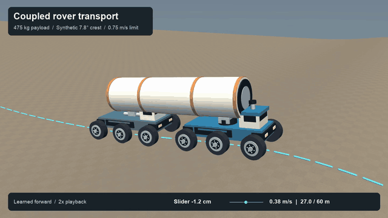

# Learned control vs. classical MPC for a cargo rover convoy

A MuJoCo reproduction of Krawciw et al., [*Sharing the Load: Autonomous Multi-Rover Cargo Transport*](https://arxiv.org/abs/2510.18766v2) (which went straight from small-scale to full-scale hardware without physics simulation), comparing a **strictly pose-only learned PPO policy** against the **pinned upstream VT&R3 distributed MPC**.

## Thesis

Classical control (such as kinematic MPC) is often preferred in robotics because learned control has historically carried high engineering overhead: building simulation environments, configuring rewards and observation spaces, and re-running training whenever a physical parameter changes. **Agentic coding largely eliminates that setup friction.** Once a fast simulation and evaluation harness is in place, testing hypotheses—matching sensor inputs, generalizing across payload mass, speeds, reverse dynamics, and cargo spans—takes minutes rather than weeks, allowing learned control to outperform a kinematic model on 3D dynamics it can directly experience in training.

*Note on process and scope:* I read the paper, formulated the research hypothesis and experimental design myself, and directed an AI coding agent to build the MuJoCo environment, observation-matching layer, reward shaping, and training/evaluation infrastructure. All numbers below are **simulation-only** (100 Hz MuJoCo physics) and do not replace field testing.

## Watch it run

**Forward crest** (475 kg payload, 7.8° crest — left: pose-only learned policy, right: upstream VT&R3 D-MPC):



**Reverse crest** (role-swapped direction-of-travel frame — learned policy completes cleanly while kinematic D-MPC stops):


## Pose-only learned policy vs. upstream VT&R3 D-MPC

Both controllers receive the **exact same 2D pose-only inputs**—delayed noisy rover poses `(x, y, yaw)`, forward speed, steering angle, taught route, and a 3.75 s leader rollout—with **no cargo slider sensor, no IMU roll/pitch, no lateral slip, and no 3D height**. The follower computes pose-derived Euclidean spacing error and closing rate from those noisy 2D poses (`field_pair.pose_derived_spacing`), and two independent 2×64 `Tanh` actors replace the online Ipopt solver.

| Suite | Task | Learned (`pose-only`) | Upstream VT&R3 D-MPC |
| --- | --- | --- | --- |
| **Field** (10 Hz, 3 seeds) | Forward crest | **3/3**, 5.28 cm [4.70, 6.02] | 3/3, 6.38 cm [5.95, 6.93] |
| **Field** (10 Hz, 3 seeds) | Forward figure-eight | **3/3**, 4.61 cm [4.42, 4.76] | 3/3, 8.39 cm [8.05, 8.77] |
| **Field** (10 Hz, 3 seeds) | Reverse crest | **3/3**, 6.09 cm [5.32, 6.85] | 0/3, 11.96 cm [11.21, 12.49] |
| **Field** (10 Hz, 3 seeds) | Reverse figure-eight | **2/3**, 6.54 cm [5.71, 7.24] | 0/3, 18.71 cm [18.03, 19.66] |
| **Docking** (10 Hz, 2 cases) | Stop, role swap, reverse dock | **2/2**, peak 6.13 cm | 0/2, peak 32.08 cm |
| **Held-out** (`n = 20`, 10 Hz) | Unseen in-distribution crests | **20/20**, 2.95 cm [2.26, 3.66] | 20/20, 3.81 cm [2.83, 4.78] |
| **Shifted OOD** (`n = 20`, 10 Hz) | Heavy load, low friction, high noise | **20/20**, 6.08 cm [5.30, 7.02] | 19/20, 8.14 cm [7.04, 9.38] |
| **High-speed** (50 Hz) | 0.75 / 1.50 / 3.00 m/s caps | **4.46 / 5.31 / 6.93 cm** (3/3) | 7.09 / 6.56 / 8.08 cm (3/3) |
| **Variable span** (10 Hz, 3 seeds) | 3.5 / 4.15 / 5.5 m cargo span | **7.30 / 5.28 / 5.91 cm** (9/9) | 7.86 / 6.38 / 7.36 cm (9/9) |
| **Compute** (CPU p95) | Per-tick inference / solve time | **0.38–0.44 ms** (~25× faster) | 8.93–13.81 ms |

Values are cargo slider RMSE (cm) with 95% bootstrap CIs where `n > 1`. Raw CSVs: [`field.csv`](results/field.csv) · [`docking.csv`](results/docking.csv) · [`heldout.csv`](results/heldout.csv) · [`shifted.csv`](results/shifted.csv) · [`speeds.csv`](results/speeds.csv) · [`spans.csv`](results/spans.csv).

## Quick start

Requires Python 3.11.

```sh
pip install -r requirements.txt
git init runs/vtr3
git -C runs/vtr3 fetch --depth 1 https://github.com/utiasASRL/vtr3.git 76433e3e1a275511ece5097d832534f6a9202da1
git -C runs/vtr3 checkout --detach FETCH_HEAD

python -m unittest discover -s tests -v
PYTHONPATH=src python src/evaluate.py --suite all --out-dir results
```
