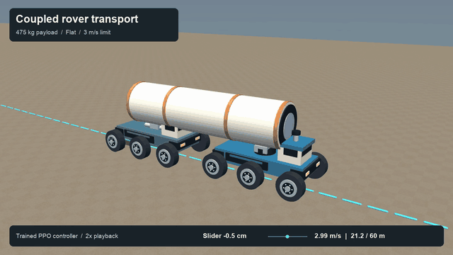

# Learning to drive a cargo rover convoy

Two simulated lunar rovers carry one payload in MuJoCo. I started with the system in *Sharing the Load* and asked whether a learned controller could finish deliveries more reliably, at a higher speed, while keeping the cargo slider closer to center. [Paper](https://arxiv.org/abs/2510.18766v2)

```text
Stored route + estimated rover state + slider reading
                         ↓
            Learned speed and steering at 10 Hz
                         ↓
           Wheel targets → coupled MuJoCo physics
```

## Watch it run



**Flat speed test.** The selected policy completed 60 m in 25.1 simulated seconds under a 3 m/s command ceiling.


**Loose crest.** The same policy completed the 60 m, 540 kg synthetic crest run in 26.2 simulated seconds. Both clips play at 2× and show the simulated speed and slider displacement. These demonstrations are separate from the reserved test suite.

## What I tried

I started with a single PPO policy for both rovers. Giving it upcoming route curvature helped it complete high-speed bends. A stronger slider-centering penalty improved the best seed, which became the incumbent. I then tested a penalty for outward slider motion and tried SAC using the same observation and action interface. A separate leader–follower experiment used two learned actors and a shared training critic. At runtime the leader reads its own channels. The follower reads its own channels plus the slider and relative-state information, including leader speed and yaw rate.

Each experimental candidate received 196,608 new PPO or SAC steps with the same outward-slider reward. Predictive PPO resumed the incumbent. SAC and leader–follower learned first from the incumbent's demonstrations and then continued online. Those initializations differ, so the results compare practical training recipes.

### How the policy was selected

On eight development trials, I ranked candidates by completions, then worst slider peak among finishes, then mean time above 10 cm, and finally delivery time. The incumbent won. [Development results](results/select.csv)

| Centralized candidate | Finished | Worst slider peak on finishes |
| --- | ---: | ---: |
| **Incumbent PPO** | **6/8** | **19.17 cm** |
| Predictive-slider PPO | 6/8 | 20.25 cm |
| SAC pilot | 0/8 | — |

### Reserved tests

The selected checkpoint was frozen before its reserved tests. All methods used the same MuJoCo plant, synthetic pose-estimation conditions, actuator bounds and stop rules. [Full reserved results](results/test.csv)

| Controller | 0.75 m/s field-envelope courses | 3 m/s simulator stress courses | All courses |
| --- | ---: | ---: | ---: |
| **Selected PPO** | **2/2** | **4/4** | **6/6** |
| Upstream VT&R3 D-MPC | 2/2 | 2/4 | 4/6 |
| Learned leader–follower | 0/2 | 3/4 | 3/6 |

On the reserved 3 m/s crest, selected PPO reduced slider RMSE from **23.40 to 4.62 cm**, with delivery time **26.7 vs. 26.9 s** for D-MPC and PPO respectively. D-MPC tracked the straight course more tightly. The selected PPO's largest slider excursion was **18.47 cm**. The three leader–follower stops were triggered by slider travel.

The field-envelope comparisons use 475 kg, the paper's 0.50 m/s D-MPC cruise, and a shared 0.75 m/s command limit. PPO chooses its speed within that limit, so elapsed time there compares different speed-selection strategies. The 3 m/s runs share the same ceiling and D-MPC cruise target.

## What came from the paper

The simulator uses the LELR six-wheel layout, a simplified cargo mount, and ±50 cm of slider travel. The baseline calls the authors' pinned VT&R3 leader and follower solvers. The follower receives the leader's predicted poses and tracks the Euclidean gap. The simulator supplies the route, pose estimates, and actuator interface. The figure eight and crest are synthetic, and the exact field revision, terrain, sensing pipeline, reverse docking, and hardware performance remain outside this comparison. PPO also receives pitch and a simulated slider reading, so this is a system-level comparison. [Controller and field setup](https://arxiv.org/html/2510.18766v2) · [VT&R3 source](https://github.com/utiasASRL/vtr3)

## Quick start

Use Python 3.11. FFmpeg is needed for video export.

```sh
python3.11 -m venv .venv
source .venv/bin/activate
pip install -r requirements.txt

git init runs/vtr3
git -C runs/vtr3 fetch --depth 1 https://github.com/utiasASRL/vtr3.git 76433e3e1a275511ece5097d832534f6a9202da1
git -C runs/vtr3 checkout --detach FETCH_HEAD
python -m unittest discover -s tests -v

python src/render_convoy.py --model assets/selected.zip --speed-limit 3 --course loose-crest --playback 2

mkdir -p runs/reproduction
cp results/selection.txt runs/reproduction/
cp assets/selected.zip runs/reproduction/selected.zip
python src/experiment_suite.py test --incumbent assets/selected.zip --leader-follower assets/leader-follower.zip --vtr3 runs/vtr3 --out runs/reproduction
```

## Code and training

- [Environment and rewards](src/environment.py) own physics, sensing, and stop checks. [Routes](src/routes.py) own path geometry and loop projection.
- [Training](src/training.py) builds and resumes the baseline PPO. [Experiment training](src/train_experiment.py) runs predictive PPO, SAC, and the [two learned actors](src/learned_control.py).
- [Benchmark](src/benchmark.py) runs controllers through one simulator interface. [VT&R3 adapter](src/vtr3_mpc.py) verifies and calls the upstream files. [Experiment suite](src/experiment_suite.py) holds the development and reserved configurations.

The runtime still uses NumPy arrays and Torch tensors. In three local runs, median simulator-step time was about **0.89 ms before and 0.88 ms after** the changes. The 95th-percentile step measurements ranged from **1.08 to 1.15 ms**. The reserved benchmark CSV records per-controller command timing separately.

To repeat candidate training, run `python src/train_experiment.py METHOD --teacher assets/selected.zip --out runs/METHOD`, with `METHOD` set to `ppo`, `sac`, or `leader-follower`. The recorded SAC pilot used `--workers 2`; PPO and leader–follower used three. Use `python src/experiment_suite.py select --help` for the selection command. The shipped 35-input checkpoint remains in `assets/policy.zip` for the earlier benchmark. [Architecture details](docs/ARCHITECTURE.md)
