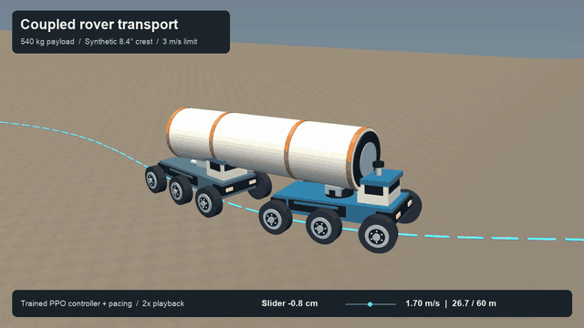

# Learning to drive a cargo rover convoy

Two simulated lunar rovers carry one shared payload in MuJoCo. I wanted to see whether a single learned controller could move the same cargo faster while keeping the slider closer to zero. I used the convoy in *Sharing the Load* as the starting point. [Paper](https://arxiv.org/abs/2510.18766v2)

```text
Taught path + rover pose estimates + slider reading
                        ↓
            One PPO policy at 10 Hz
                        ↓
           Speed and steering for both rovers
                        ↓
         Wheel targets → coupled MuJoCo physics
```

## Watch it run

**Flat speed test.** The policy completes 60 m in 25.1 simulated seconds with a 475 kg payload. Both rovers sustain about **2.99 m/s** through the middle of the route under a **3 m/s command ceiling**.


**Loose crest.** The same checkpoint completes 60 m in **38.7 simulated seconds** with a 540 kg payload and the same 3 m/s ceiling. The curvature-based speed envelope lets it ease off before the bends.



Both GIFs show highlights from recorded MuJoCo runs at **2× speed**. The overlay reports physical simulated speed and slider displacement.

## How I approached it

1. **Model the coupled vehicles.** The [MuJoCo configuration](assets/convoy.xml) models two six-wheel LELRs, a 475 kg payload, a front mount with yaw and pitch motion, and a rear spherical connection on a ±50 cm slider. I used the paper's joint arrangement and the lab's public drive limits. Mount geometry, tire response and suspension are approximations. [Field hardware](https://arxiv.org/html/2510.18766v2#S8) · [Public LELR settings](https://github.com/utiasASRL/vtr3/blob/76433e3e1a275511ece5097d832534f6a9202da1/config/lelr_convoy.yaml)
2. **Keep the controller compatible with Teach & Repeat.** The policy reads pose estimates, upcoming poses along a stored route, rover motion and the slider reading. At the 3 m/s setting it uses headings about 5 and 9 m ahead. In simulation the route and pose errors are synthetic. A real experiment would use the lab's taught route and pose estimates.
3. **Reward the whole delivery.** Early policies learned to move, but often lost the path at higher speed. I changed the reward to pay for progress and completion, charge for elapsed time, and penalize slider error symmetrically around zero. The two delivery models each trained for 524,288 steps from the earlier speed-conditioned policy's actor, with randomized course shape, grip, payload, grade and pose error.
4. **Test speed on different routes.** I gave the policy a 3 m/s ceiling on both flat ground and a loose crest. For the paced variant, the stored route curvature limits speed before bends. The benchmark applies the same envelope to both controllers with `--paced`.

## Results

I compared the two PPO seeds and D-MPC on the same 60 m courses, load, actuator limits, and synthetic pose-estimation conditions. Each speed has five trials, including two noisy runs on the loose crest. The 1.5 and 3 m/s targets are simulation stress tests. The paper's loaded trial used 0.5 m/s nominal speed and a 0.75 m/s command limit. [Field-test protocol](https://arxiv.org/html/2510.18766v2#S9)

| Command ceiling | Speed envelope | D-MPC finished | PPO seed 0 finished | PPO seed 1 finished |
| --- | --- | ---: | ---: | ---: |
| 0.75 m/s | Off | 2/5 | 5/5 | 5/5 |
| 1.50 m/s | Off | 2/5 | 5/5 | 5/5 |
| 3.00 m/s | Off | 4/5 | 2/5 | 2/5 |
| 3.00 m/s | Shared | 3/5 | 2/5 | **5/5** |

- **Completion and compute time.** With the shared speed envelope at 3 m/s, seed 1 finished both loose-crest runs. D-MPC stopped at the slider limit on both. The median of the per-run controller p95 wall times was 0.72 ms for PPO and 32.95 ms for D-MPC on the benchmark machine. This measures command computation, including the speed envelope, and excludes simulation stepping and model loading.
- **Slider control and delivery time.** On the unpaced 475 kg crest at a 3 m/s limit, the shipping PPO checkpoint completed in 25.5 s with 7.51 cm slider RMSE. D-MPC took 25.3 s with 20.52 cm slider RMSE. Where both methods finished the same run, neither PPO seed recorded a simultaneous improvement in elapsed time and slider RMSE in this benchmark.
- **Where MPC still led.** On the flat 0.75 m/s route, both the shipped policy and D-MPC took 81.5 s. Peak lateral error was 1.13 cm for PPO and 0.03 cm for D-MPC. At 3 m/s without pacing, both PPO seeds left the allowed path on the bends and the loose crest. The difference between the PPO seeds with pacing also makes training variability part of the result.

The D-MPC comparison uses a reconstruction from the paper and public settings on the same MuJoCo platform. The leader solves a path-tracking problem and passes its predicted poses to the follower, whose problem also tracks the nominal Euclidean gap. The acceleration-feasible lookahead, synthetic routes and actuator model are part of the reconstruction. The PPO uses pitch and the simulated slider sensor. The D-MPC uses the pose-based gap, as described in the paper. These are system comparisons in simulation. The field controller and telemetry would be needed for a hardware comparison. [Paper, distributed MPC](https://arxiv.org/html/2510.18766v2#S3.SS4)

## Quick start

Use Python 3.11. FFmpeg with `libx264` is needed for video export.

```bash
python3.11 -m venv .venv
source .venv/bin/activate
pip install -r requirements.txt

python src/benchmark.py --speed 0.75
python src/benchmark.py --speed 3 --paced
python src/render_convoy.py --model assets/policy.zip --speed-limit 3 --course flat --playback 2
python src/render_convoy.py --model assets/policy.zip --speed-limit 3 --course loose-crest --paced --playback 2
```

Running `python src/benchmark.py` without a speed filter runs the full comparison at 0.75, 1.5 and 3 m/s. The CSV in `runs/benchmark.csv` reports every rollout, including the stop trigger, solver failures and controller timing. Use `--out` to preserve separate result files.

To train in two stages, first build the speed-conditioned actor, then fine-tune for delivery. The shipped checkpoint is seed 1 from the delivery stage, which had the highest completion count in the paced simulation. Seed 0 is included in the comparison so the results show the variation across training runs.

```bash
python src/convoy.py train --speed-conditioned --seed 0 --steps 163840 --out runs/speed
python src/convoy.py train --delivery --seed 1 --workers 4 --steps 524288 --initialize-from runs/speed/ppo.zip --out runs/delivery
```

- [`src/convoy.py`](src/convoy.py) contains the Gymnasium environment, reward, training and speed sweep.
- [`src/benchmark.py`](src/benchmark.py) contains the D-MPC reconstruction and matched evaluation.
- [`src/render_convoy.py`](src/render_convoy.py) renders a trained policy with route and slider overlays.
