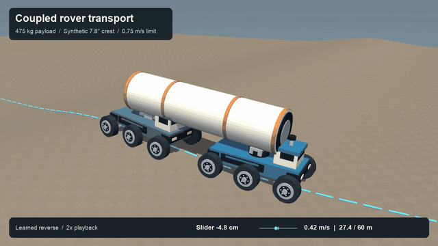

# Learned control for a cargo rover convoy

I reproduced the coupled-cargo task from *Sharing the Load* in MuJoCo to compare the authors’ distributed MPC with two learned rover policies. Both controllers drive the same simulated rovers over a taught route while carrying a shared load. [Paper](https://arxiv.org/abs/2510.18766v2)

```text
Leader: taught path + pose → speed and steering → predicted poses
                                                      ↓
Follower: own pose + slider reading + predicted poses → speed and steering
```

## Watch it run

**Forward crest.** The learned pair follows the taught route with a 475 kg payload.


**Reverse crest.** The rover at the back becomes the leader, and both rovers back along the route. The policy receives inputs in the direction-of-travel frame. Both clips replay simulated motion at 2× speed.



## What I trained

My first learned follower kept falling behind because the leader drove near the 0.75 m/s ceiling. I trained the leader to cruise near **0.50 m/s** so the follower had room to correct the gap. The reward pays for route progress and completion, charges for elapsed time and path error, and penalizes the magnitude and speed of slider motion. The follower receives a 3.75-second leader forecast and reference poses on its own route.

I initialized both actors with simulated demonstrations and trained them with **Stable-Baselines3 PPO**. The selected forward checkpoint had **32,768 PPO steps**. I then collected mixed-direction demonstrations, ran **32,768 more PPO steps**, and adapted the actors on **52,664 labeled states** with a direction input and a reverse steering teacher. A final **16,384 PPO steps** brought the total to **81,920 PPO steps** from the supplied initialization. At test time, the actors choose the commands. The direction adapter maps them to the wheels.

## Results

| Test | Learned | Upstream VT&R3 |
| --- | ---: | ---: |
| Forward crest and two-lap figure eight | 6/6 | 6/6 |
| Reverse crest | 3/3 | 0/3 |
| Full reverse figure eight | 1/3 | 0/3 |
| Forward, stop, swap roles, then reverse to the docking target | 2/2 | 0/2 |

The forward-only checkpoint completed three reverse crest runs and stopped on all three full reverse figure-eight runs. Training in both directions brought the reverse figure eight to **one completion in three repeats**. The full reverse loop is a stress test; the paper used reverse segments within a mixed-direction route. In forward transport, slider RMSE was **2.24 vs. 6.38 cm** on the crest and **2.40 vs. 8.39 cm** on the figure eight, for learned control and VT&R3 respectively. The learned pair took about **37 s longer** on the forward figure eight. The two docking approaches passed the simulator’s **25 cm longitudinal, 15 cm lateral, and 5° heading tolerances**. These approaches use a shared stop-and-swap procedure and a taught final segment.

The comparison calls the pinned VT&R3 solvers and uses the paper’s field-speed settings. The terrain, pose estimates, cargo mount, and docking target are modeled in MuJoCo. The learned leader predicts from its latest command. VT&R3 optimizes a command sequence over its horizon. [Paper method](https://arxiv.org/html/2510.18766v2#S3) · [Direction trials](results/test.csv) · [Role-swap and docking trials](results/maneuver.csv)

## Run it

Use Python 3.11. FFmpeg is needed to export replays.

```sh
pip install -r requirements.txt
git init runs/vtr3
git -C runs/vtr3 fetch --depth 1 https://github.com/utiasASRL/vtr3.git 76433e3e1a275511ece5097d832534f6a9202da1
git -C runs/vtr3 checkout --detach FETCH_HEAD

python src/direction_trials.py --model assets/field-bidirectional.zip --out runs/forward.csv
python src/direction_trials.py --model assets/field-bidirectional.zip --reverse --out runs/reverse.csv
python src/maneuver.py --model assets/field-bidirectional.zip --vtr3 runs/vtr3 --out runs/maneuver.csv
```

[Training, replay, and source layout](docs/ARCHITECTURE.md)
